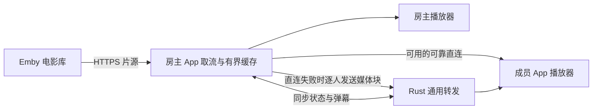

# 电影厅房间方案

此文保留本聊天早期设计，属于历史草案。2026-10-13 拉取 `d2c70cc` 后，本次评估以 [观影房与 Windows 方案](WATCH_ROOM_PLAN.md) 为准：六人含房主、各端直接取 Emby、房间实时弹幕与自有协议语音。下文的十人、房主分发视频及按电影进度显示弹幕，不作为最新方案的实施要求。评估见 [新增待办评估](TODO_ASSESSMENT.md)。

2026-10-13，设计草案，尚未实施。目标是在赛博房间 App 内由房主选择 Emby 电影，最多十人同步观看，随时加入并发送弹幕。

用户已提出电影厅、房主选片、随时加入、不等人齐、最多十人、弹幕及 Emby 片源。本文暂按“十人包含房主；只有房主登录 Emby，成员无需账号”设计，账号方式尚待用户选择。同步阈值、画质、后台规则和开发顺序均是建议，不是既有实现或已确认要求。

## 使用流程与权限

房主在建房页选择“电影厅”，填写房间名，连接自己的 Emby，浏览或搜索电影，选好后点击播放。房主一人就能开始，没有准备按钮和人数齐备条件。未选片也能建房，成员进入后看到“房主正在选片”。

成员从大厅进入电影厅，自动获得当前电影、成员列表和播放进度。电影已经播放时，从大家当前看到的位置开始，不从片头开始；加入者自己的加载过程不暂停其他人。若系统要求用户手势，则显示“点击加入播放”，点击时重新取得当前进度。

| 操作 | 房主 | 成员 |
| --- | --- | --- |
| 选片、换片、暂停、继续、拖动进度 | 可以，作用于整个房间 | 不可改变全房进度 |
| 调音量、亮度、全屏、开关弹幕 | 仅改变自己的设备 | 仅改变自己的设备 |
| 暂时停止自己观看 | 首版提示会暂停全房 | 可以，回来时追上房间 |
| 发弹幕 | 可以 | 可以 |
| 禁言、移出成员、解散 | 可以 | 可以自行退出 |

容量固定为 10 人，包含房主。选片中、播放中、暂停、换片和播放结束都允许加入，房满才拒绝。房主串行处理准入并立即占位；重复申请或同身份恢复不重复计数。未完成入房且长期无业务确认的占位应有短期回收，取消和迟到回复不得留下幽灵成员。

沿用当前规则：房主主动退出直接解散，不转移房主；普通成员退出不影响其他人。播放结束停留在厅内，由房主再次选片。

## 视频怎样送到成员

在“房主自己的 Emby、成员无需账号、继续只扩展客户端”的前提下，首选房主取流并分发编码后的媒体字节。不会录屏，也不在手机上重新压制整部电影。

视频和控制消息复用现有协议外壳；电影厅自己定义媒体请求、分块、确认及播放状态。Rust 不认识 Emby、电影、弹幕或十人限制，不新增业务功能号、正式成员表或准入判断。房主只给当前获准成员发送内容，成员只接受当前房主的状态、媒体和弹幕广播。

不同片源条件可以选择其他路径，但不要一次实现三套：

| 方式 | 条件与代价 | 定位 |
| --- | --- | --- |
| 房主取流后分发 | 成员无需 Emby 账号；占用房主上行与电量 | 符合当前框架边界的首选方案 |
| 各成员直接访问 Emby | 每人有合法播放凭据、能访问同一片源；Emby 承担多路出口和可能的转码 | 若用户选择每人登录，可大幅简化媒体传输 |
| Emby 旁独立播放代理 | 需额外部署；代理提供仅限该房间、影片和成员的可撤销访问凭据 | 若十人稳定播放优先且房主上行不足，优先考虑 |

独立播放代理属于新增组件，不能悄悄塞入通用 Rust 服务端。没有依据假设 Emby 用户 token 天然是“仅限这一部电影的临时票据”。不向成员发送房主密码、用户 token、管理员 API key，或含这些值的原始播放链接。Emby 登录返回的 AccessToken 是后续 API 凭据，应绑定服务器保存在房主设备原生安全存储中。[Emby 用户认证](https://dev.emby.media/doc/restapi/User-Authentication.html)

## Emby 与播放器接入

房主 App 原生侧负责登录、查询电影、取得 PlaybackInfo 和 MediaSources，固定本次播放所用的影片版本。不同剪辑版本不能只凭标题认为进度相同。实际接入按目标 Emby 版本协商可播放格式及清晰度；容器或编码不兼容时交由 Emby 转封装或转码。MediaSources 提供码率、容器、媒体轨道及各版本时长，PlaybackInfo 提供播放源信息。[播放源选择](https://dev.emby.media/doc/restapi/Playback-Guidelines.html)、[PlaybackInfo API](https://dev.emby.media/reference/RestAPI/MediaInfoService/postItemsByIdPlaybackinfo.html)

首版建议使用一条全房共享、以 H.264/AAC 为兼容目标的 HLS 输出，优先保留可直接使用的音视频编码；不能把“采用 HLS”写成“一定不转码”。房主取清单和分段，在有界缓存中合并相同请求，再供自己及成员播放。房主不为每个成员重复启动一个 Emby 转码任务。HLS 是 Emby 已提供的取流方式，但共享清单、拖动后分段可用性和具体转码行为需要用真实 Emby 验证。[Emby HLS](https://dev.emby.media/doc/restapi/Http-Live-Streaming.html)

房主需要管理播放会话：开始、定期进度、停止时上报 Emby；房间解散、换片或结束后关闭本模块拥有的旧转码会话。专用 DeviceId 隔离本 App 的取流，避免清理其他播放器的任务。进度上报反映房主播放，不由十个成员竞争覆盖同一个账号的续播记录。[播放会话上报](https://dev.emby.media/doc/restapi/Playback-Check-ins.html)

Android 建议使用 Media3 ExoPlayer 原生播放器和自定义 DataSource，接入房主缓存或成员收到的分段。HLS 清单中的片段、初始化段、音轨、字幕及可能的密钥引用，都需转换为本模块资源标识；不能把上游带凭据的 URL 原样传出。房主只允许请求本次清单已登记的资源和有界范围，不开放任意 URL 或本地路径下载接口。Media3 支持 HLS 的 MPEG-TS、fMP4 等容器，具体音视频解码能力仍取决于设备。[Android HLS 支持](https://developer.android.com/media/media3/exoplayer/hls)

大厅、房间成员、权限、同步策略和弹幕逻辑继续使用共用 JS；Java 只提供媒体取流、缓存、播放器及必要传输接口，不复制一套房间规则。原生视频表面与透明的本地 UI 叠加，确保全屏仍显示弹幕。字幕单独渲染；首版可共享一条音轨，支持选定字幕的开关，逐人独立音轨和画质留待有实际需要时扩展。

当前 WebView 只允许本地资源，不能直接塞入 Emby 网页或 iframe；现有媒体手势限制也不能当作自动播放已实现。大块视频应留在原生侧，避免反复经过 JS 与 Base64 桥接。新增接口只向受信任的本地页面暴露，媒体路径仍校验房主与获准成员。

首期交付范围建议为 Android 房主与 Android 成员。网页共享电影厅的模块定义，但在 Web 播放适配完成前明确显示需要 App，不宣称已能跨端观影。网页适配需要额外解决 HLS 加载、浏览器支持、自动播放限制，以及浏览器作为房主时访问 Emby 的跨域和 HTTPS 条件；目前网页也没有 WebRTC 直连。

## 同步播放与中途加入

房主是播放时间线的唯一决定者。最小状态包含：影片与媒体源标识、播放代次、递增状态版本、播放或暂停、基准电影进度、房主单调时钟基准及倍速。字段仅属于电影厅正文，不写入通用包头规范。

播放时，目标进度等于“基准电影进度 + 自基准时刻起经过的时间 × 倍速”；暂停时保持基准进度。客户端通过多次往返测量估计与房主单调时钟的差值，优先低往返延迟样本，不依赖各手机系统时间相同。房主定期用真实播放器进度修正时间线。

1. 成员通过 JOIN 获准，得到成员列表、完整播放状态和媒体描述。
2. 加入者缓冲当前进度附近可解码的分段与初始化数据；不能从任意视频字节开始解码。
3. 缓冲完成后再次取得最新状态，计算此刻进度再开始，避免等待缓存造成落后。
4. 房主操作立即发布，正常播放约每 2 秒校准一次。开始、继续和拖动可安排约 0.5–1 秒后的共同生效时刻，不要求所有成员准备完成。
5. 初始调参建议：误差小于 300 ms 不调整；300 ms–1 秒短暂微调播放速度；大于 1 秒或收到拖动命令时定位并重新缓冲。目标是一般网络下稳定在约 0.5 秒以内，属于待验证目标，不承诺逐帧同步。

每次换片增加播放代次，废弃旧影片的媒体、操作及弹幕。拖动导致上游流重建时也更新媒体代次，并使用绝对电影进度映射新流的起点；不能把转码后从零开始的播放器时间当作电影从头播放。迟到或重复消息按代次、状态版本和操作 ID 丢弃。

成员卡顿只让该成员缓冲，恢复后追上大家；房主播放器或上游片源卡顿则暂停全房时间线，恢复后由房主继续。成员可以请求暂停，但首版仍由房主决定。影片码率超出个别成员网络时给出明确提示，不无限增加缓存；首版可由房主统一降档，不自动为每人开一条转码。

## 可靠传输与资源预算

现有帧正文上限 64 KiB；媒体块建议先用 32 KiB，每个媒体对象可以分多帧。媒体对象编号、偏移、总长度、请求 ID、播放代次和校验信息只在电影厅客户端定义。收齐并校验后交给播放器，缺块重取，超时或换片取消，所有队列、缓存和重组均有上限。

当前原生 UDP 只有有界分片，没有逐片可靠确认，并有每对端 256 KB/s 的发送预算。它不能直接被视为可持续播放 4 Mbps 电影的可靠媒体通道。电影厅若使用直连，需在客户端补齐窗口、块确认、重传、拥塞控制及持续吞吐判断；失败转 TCP/WSS。开发先用可靠中转打通完整体验，再接入可靠直连，最终保留直连优先和失败中转的产品方向。

单成员慢网不得阻塞全房。为每个成员维护独立、有界的在途请求窗口，另设房主总预算，控制和心跳优先于尚未发送的视频块。Rust 现有连接队列有界，向其持续灌入大量媒体会拖延控制消息；客户端必须限制入队量。sendTo 成功和服务端入队回执都不表示成员已经收到完整媒体或完成播放。

房主缓存建议以约 20 秒、最多 32 MiB 为首轮调参起点，同时设时间与字节上限；成员缓存约 3–8 秒，并限制总字节。缓存淘汰不影响正在引用的分段，过慢的成员重新对齐当前进度，避免为其长期保留旧片段。普通会话身份可跨重连恢复，但媒体请求和在途块必须重新核对代次。

按房主加九名成员、每路平均码率 R 估算，不含协议、重传及峰值开销：

| 资源 | 房主分发方式的预算 |
| --- | --- |
| Emby 到房主 | 约 R；缓存合并同一媒体请求是前提 |
| 房主总上行 | 约 9R；当前 SEND 每次只有一个目标，走中转也不会自动变成一份上传 |
| 每个成员下行 | 约 R |
| 全部中转时 Rust 入口与出口 | 各约 9R |

R 为 4 Mbps 时，房主约需 4 Mbps 下行和 36 Mbps 上行；全中转的 Rust 约需 36 Mbps 入口、36 Mbps 出口，出口流量约 16.2 GB/小时。实际还应预留开销。首轮可从 720p、约 2–4 Mbps 做体验与容量验证，不默认十人 4K。人数上限并不能证明网络、Emby 或手机足以支撑对应画质。

若房主上行经常不足，应改选“各成员直取”或独立播放代理；仅降低同步消息频率解决不了视频带宽问题。共享 HLS 输出可减少上游重复取流，具体转码任务数与缓存命中不能未经实测承诺。

## 弹幕与界面

成员把弹幕交给房主；房主根据可信连接来源验证成员身份、禁言状态和频率，赋予递增编号及电影进度，再分发给所有获准成员。接收端只渲染房主广播，防止成员绕过禁言直接向其他人发送。首版建议纯文本，最多 50 个 Unicode 字符，每人每秒 1 条、允许短时突发 3 条；服务端无需理解弹幕。

弹幕附带播放代次和影片进度，在各自播放器走到相应位置时出现；本地卡顿时随画面暂停，过迟消息可留在聊天记录而跳过滚动，避免恢复后集中刷屏。暂停期间新消息显示在静态聊天区。默认不在倒退时重复滚动已看弹幕，换片清空旧影片滚动队列；房主只保留例如最近 200 条的有界记录，中途加入无需重播全部历史。

竖屏为上方视频、下方成员和弹幕输入；横屏全屏时覆盖弹幕和可收起的操作栏。成员显示“跟随房主”“缓冲中”“暂离”等真实状态。房主独有换片、全房播放控制和成员管理；所有人可本地关闭弹幕、调节字号及透明度，弹幕默认避开字幕区。房间内显示电影名、进度和人数即可，不增加游戏式座位和准备流程。

大厅首版只列电影厅类型与房间名称。现有 LIST 没有在线人数和片名；不凭通信关联数冒充正式成员数。需要大厅实时显示“7/10、正在播放某片”时，再由客户端定义受限的房主状态查询，或另行评估通用目录扩展。

## 断线与退出

| 情况 | 建议行为 |
| --- | --- |
| 成员短暂断网 | 保留恢复机会；重连后重新获准并取得快照，追上当前进度 |
| 成员进入后台 | 暂停自己的画面及不必要的媒体拉取；回来后重新同步，其他人继续 |
| 房主进入后台 | 首版主动暂停全房；仍维护必要通信，不直接解散 |
| 约 5 秒没有房主业务状态 | 成员停止推进并显示“等待房主恢复”，不误判为主动退出 |
| 房主恢复同一有效会话 | 校验房间仍存在，重建媒体会话并发布完整状态；进程重建先暂停，重建单调时钟基准 |
| 房主主动退出或会话到期 | 关闭电影厅，停止取流、播放器和转码，释放缓存及成员状态 |
| Emby 登录失效或片源不可用 | 保持房间并显示片源错误，由房主重新登录或换片 |

沿用现有“最后一次有效心跳后 60 秒”的服务端会话清理语义，业务超时提示不冒充服务端已解散。服务端重启房间丢失，不自动凭旧快照复活。锁屏继续放映和画中画可后续再做，不把现有前台服务等同于已验证所有厂商后台行为。

成员退出、被移出或房间关闭后，房主停止处理其新媒体请求；所有新消息重新验证权限。已经交付并缓存到成员设备的内容无法远程收回，不能声称踢人会抹掉已经收到的媒体。

## 代码范围与开发顺序

以 `RoomClient` 组合一个独立电影厅控制器，复用必要的成员和传输代码；不要硬套 `GameRoom` 当前“开始后禁止加入、满员准备开局”的规则。仅在确有重复时抽取小函数，不先构建新的插件框架。

| 范围 | 计划修改 |
| --- | --- |
| 共用 web 客户端 | 新增电影厅模块、建房类型、入房分流、房主状态同步、弹幕和观影界面 |
| Android 壳 | Emby 客户端、原生播放器、有界媒体缓存、DataSource、受限桥接及二进制媒体传输 |
| 原生 UDP | 电影厅媒体所需的可靠传输与流控；现有玩法继续保持原有行为 |
| Rust | 复用七个基础功能，不增加电影厅分支；容量瓶颈若需调整，仅单独评估通用资源预算 |

建议顺序：先完成房主单机 Emby 播放；再打通两台 App 的中转观看、暂停和拖动；接入十人准入、中途加入、弹幕、断线恢复及清理；随后加入可靠直连并完成电影厅集中验收。网页观影和独立播放代理另列后续范围，避免首轮同时铺开。

开发期间按项目约定仅做必要编译和阻塞问题检查，功能齐备后集中验证：十人同时观看、第十一人被拒且不占位、并发争最后一位、影片中途加入、反复拖动和换片、成员慢网、房主恢复和解散、UDP 失败中转、弹幕权限与去重、Emby 转码退出清理、敏感凭据不外发及长时内存有界。真机兼容、同步误差、十人吞吐和电量需真实设备及片源测量，不以构建成功替代。

实施前影响方案的主要条件是：成员是否各有 Emby 账号、Emby 对房主或全部成员的可达性、是否允许部署独立媒体代理，以及典型影片编码、服务器转码能力和房主上行。当前无需用户提供密码或 token。

参照现行 [客户端开发指南](FRAMEWORK_DEVELOPMENT_GUIDE.md)、[接入手册](CYBER_ROOM_INTEGRATION_MANUAL.md) 与 [框架方案](GENERIC_GAME_PLATFORM_PLAN.md)。旧 [房间管理方案](ROOM_MANAGEMENT_PLAN.md) 中的两人游戏、房主转移及旧超时参数不用于覆盖当前 v3 规则。
