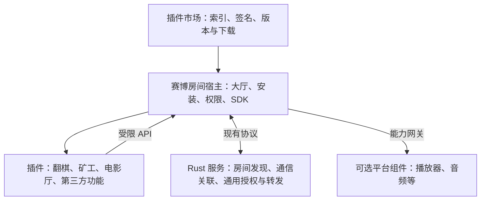

# 赛博房间插件平台方案

2026-10-15 创建，2026-10-16 用户授权开发及审查后发布、部署、关机。本文保留分析时的建议；最终 API 和实现差异以 [插件开发指南](PLUGIN_DEVELOPMENT.md) 为准，验证范围见 PROJECT_STATUS.md。

本次确认：三个已有功能分别存放于独立目录；房间固定插件，切换必须退出并重建；暂不实施更新扩大权限时的再次授权流程。基础接口范围、数据隔离和系统麦克风许可仍保留。此前仅分析限制已被覆盖，历史提交、发布、部署与关机授权不延伸至本次。

目标是把赛博房间客户端改成通用宿主：提供通信、房间管理、插件运行和统一 API；翻棋、矿工、电影厅由用户从插件市场安装。开发者为支持的平台提供实现并声明支持范围，不支持的平台不能进入该插件的房间。

## 1 已提出的目标与推荐选择

用户已提出：

- 赛博房间与 Rust 服务端一样，保留通用基础能力，剥离游戏、电影厅等业务。
- 对外提供接口和 API，功能通过插件包分发，从插件市场下载使用。
- 插件可支持 Web、App、PC 全部或其中几端，按声明限制进入。

推荐采用“小核心 + 沙箱插件 + 独立市场”。三端支持意味着三端可运行和联机，不要求开发者复制三份源码。普通插件优先共用 HTML/CSS/JavaScript 与资源，平台差异通过 SDK 适配；有必要时提供不同入口或独立实现。

首批平台明确为 `web`、`android`、`windows`；不把 App 默认等同于同时支持 iOS，也不把 PC 默认等同于支持 macOS/Linux。以下包格式、接口名和实施顺序均为建议，待讨论定稿。

## 2 当前基础与实际改造量

当前 Rust 已提供九项通用功能，保留 v3 握手、17 字节包头、原生 UDP 和 TCP/WS 中转。Rust 不需要安装游戏插件，也不应加载开发者业务代码。

当前客户端并非可安装插件的宿主：

| 现有位置 | 现状 | 需要的拆分 |
| --- | --- | --- |
| `server/src/main/resources/web/transport.js` | 通用帧、连接、收发和 NativeRoom 适配 | 留在可信核心，对插件暴露受限 SDK |
| `server/src/main/resources/web/room.js` | 固定 GAMES 表，直接导入棋局和矿工引擎；成员、恢复与玩法混合 | 提取通用房间会话；规则、准备和存档迁出 |
| `server/src/main/resources/web/app.js`、`index.html` | 大厅、棋盘、矿场、Emby 页面混合 | 留大厅、设置、市场及插件容器；业务页面归插件 |
| `game.js`、`miner.js`、`miner-view.js` | 规则、渲染、资源和音效 | 分别成为官方翻棋、矿工插件 |
| `watch.js`、`voice.js`、`subtitles.js` | 片库、同步、弹幕、音频和字幕 | 电影厅业务归插件；可复用原生能力另行拆分 |
| Android `GameService.java` | WebView 直接注入 NativeRoom；assets 打包整个共享资源目录 | 建立独立插件容器和权限网关，改为按需安装 |
| Android Media3、Windows `media.rs`/`media_runtime.rs` 等 | 原生播放和音频能力与应用一起构建分发 | 区分宿主适配和可选原生组件，验证独立分发 |
| Windows `tauri.conf.json` | frontendDist 指向全部共享网页，当前 CSP 禁止 frame | 调整资源组织和容器权限，不能只放开全部 frame/IPC |

因此可行性较高，但工作量主要在客户端宿主化、原生组件拆分和跨端验收；并非仅给几个现有 JS 文件增加下载链接。

## 3 职责边界



| 层 | 负责 | 不承担 |
| --- | --- | --- |
| Rust 通信服务 | 身份/心跳、房间发现、房主路由授权、连接清理、UDP 地址发现、不透明转发 | 玩法、片源、正式业务成员裁决、市场审核和插件执行 |
| 客户端核心 | 连接、通用房间、正式成员管理、密码/踢人、生命周期、平台及版本检查、消息隔离、安装与存储管理 | 棋局、关卡、片库、播放同步和弹幕规则 |
| 功能插件 | 业务 UI、规则、业务协议、状态同步、业务存档、自己的入房附加条件 | 读取其他插件数据、获取宿主恢复凭据、直接调用任意原生接口 |
| 可选平台组件 | 提供播放器、音频等可复用设备能力 | 解释 Emby、矿工或棋局规则 |
| 插件市场 | 开发者身份和命名空间、发布记录、平台包、检验、审核、撤回、下载 | 参与实时联机或代替房主准入 |

通用密码、人数上限、成员和踢人由宿主实现，插件提供限制和可选准入钩子。准备后开局、观影随时加入、游戏中禁止加入等属于插件策略，不统一强加给所有插件。通信关联仍不等于正式入房；服务端仅执行房主发出的 grant/revoke。

房主主动退出直接解散，沿用现有信任模型。连接重建、授权名单核对、迟到响应隔离由核心负责；棋盘/进度/计分恢复由插件处理。插件崩溃或超时不能阻止宿主退出房间。

首版一个房间绑定一个主插件，一个客户端只参与一个房间。暂不引入房间内热切换、多插件协作总线或任意插件依赖图。

## 4 插件包和三端声明

一个插件使用稳定的发布者身份和插件 ID，发布一个版本，版本下可以有共享资源及不同平台载荷。客户端只下载本端所需文件。

示意目录：

```text
gold-miner/
  manifest.json
  shared/                 # 共用业务和资源
  web/                    # 可选 Web 专用入口
  android/                # 可选 Android 专用入口
  windows/                # 可选 Windows 专用入口
  licenses/
```

建议首版标准插件载荷为 HTML/CSS/JavaScript/资源；WASM 可作为后续计算能力选项，不以实现新的跨端引擎为前置。以下为精简示例，并非已存在的格式：

```json
{
  "schemaVersion": 1,
  "id": "official.gold-miner",
  "name": "黄金矿工",
  "version": "1.0.0",
  "hostApi": ">=1.0.0 <2.0.0",
  "roomFeature": "847f9bdc31ee4ca895d42d673b6a02ae",
  "protocol": "gold-miner/1",
  "dataSchema": 1,
  "targets": {
    "web": {"entry": "shared/index.html"},
    "android": {"entry": "shared/index.html"},
    "windows": {"entry": "shared/index.html"}
  },
  "room": {"minMembers": 2, "maxMembers": 3},
  "permissions": ["room.messaging", "storage.private"]
}
```

- 只有 Web 和 Windows 实现时，删除 `android` 项；缺项即不支持，不能按设备外形猜测。
- 同一个入口可以对应多个平台，但开发者必须验证声明的平台；使用桌面浏览器仍属于 `web`。
- 平台配置可以补充最低系统/WebView 版本、CPU 架构、必需和可选能力。无需原生包的插件不强制区分 CPU。
- 支持平台首版默认同时支持作为房主和成员；仅可参与或仅可主持的角色组合先不开放，避免无意扩大兼容矩阵。
- 电影厅把视频播放列为必需能力；麦克风是可选权限。拒绝开麦不能导致无法观影和发弹幕。
- 完整发布描述另含发布者签名、各载荷大小和散列、许可声明。签名覆盖清单及载荷映射；载荷散列不放进会导致自身散列循环的结构。
- 同一发布的 Web、Android、Windows 文件可以不同，不能要求跨平台 ZIP 的 SHA-256 相等；比较统一发布身份，再验证各端对应散列。

当前功能标识可沿用以减少迁移工作，其后半段仍是公开匹配值，不是密码或安全凭据。市场负责防止发布者冒用 ID；房主提供的字符串不构成插件身份认证。

## 5 SDK 和 API

向开发者提供版本化 JS SDK、类型定义、示例插件、清单校验器、本地调试宿主和打包工具。原生组件使用同一概念模型的受限 IPC 适配，不让业务各自重写握手和 UDP。

| API 分组（建议命名） | 功能 |
| --- | --- |
| `runtime.info / capabilities` | 实际平台、SDK 版本、已安装能力、视口与生命周期 |
| `room.context / members / onEvent` | 当前房间、可信本机身份、房主与获准成员及变化 |
| `room.create / join / leave` | 通用房间操作，经宿主校验并限定当前插件 |
| `room.send / broadcast / onMessage` | 定向与指定广播、JSON/二进制数据、网络状态 |
| `room.host.*` | 房主批准/拒绝/踢人等受限操作；实际房主身份由核心核对 |
| `storage.get / set / delete` | 按发布者、插件与本地用户上下文隔离的存档和设置 |
| `permissions.request` | 用户可理解的权限请求，撤销后立即停止使用 |
| `ui.fullscreen / openExternal` | 全屏、返回与用户明确触发的外部导航 |
| `network.fetch`（按权限） | 面向获准业务来源的请求，检查协议、重定向和响应上限 |
| `capabilities.acquire`（可选） | 获取已安装的播放/音频等受限组件接口 |

核心只提供通用接口，不出现 `loadEmbyLibrary`、`moveChess` 等业务方法。插件不拿到完整 RoomClient、NativeRoom、Tauri invoke、文件路径或恢复 token。身份、房间和插件运行代次由网关绑定，不能接受插件自报字段覆盖。

建议生命周期包括启动、进入房间、成员变化、前后台、重连、结束与销毁。所有订阅、定时任务、音频和播放器句柄均在实例销毁时清理；旧实例回调不能影响新房间。引擎和渲染按现有需要拆分，不额外建立多层业务框架。

传输保留直连优先与失败中转；浏览器走 WS/WSS，不引入 WebRTC/TURN。SDK 明确区分入队结果、送达反馈和业务执行确认。金额/计分/动作去重、快照序号、迟到动作裁决属于插件协议，不宣称一次发送等于恰好执行一次。

## 6 未安装插件的房间如何被发现

当前 LIST 必须按 `roomType` 查询，返回 roomId/name/hostId/locked；现有大厅又只遍历固定 GAMES。仅移除这个表，无法自然发现所有第三方插件房间。

推荐最小通用扩展：

1. LIST 支持分页查询全部房间，仍允许按 roomType 过滤，返回 roomType。
2. CREATE 支持有长度上限的、不透明的公开描述 `metadata`，LIST 原样返回。初始建议上限 2 KiB，同时按实际编码大小控制每页总字节数，不固定凑满 64 条导致溢出。
3. 客户端描述包含插件 ID、固定发布 ID、协议版本、支持目标等。Rust 只约束大小/外壳和保存字节，不理解游戏或验证插件平台。
4. 服务端通过 READY 声明支持该扩展；旧服可降级成按已知插件查房，不能把空列表误报成没有房间。

以上是新增设计，不是当前已具备功能。现有 v3 握手和功能号原则上可沿用，是否需要修订具体字段在接口定稿时确认。

公开描述不含房间密码、片源凭据、游戏存档。客户端下载时依据可信市场中的插件 ID 与发布 ID 查包，不执行房主描述提供的任意下载 URL。描述只是发现提示，最终由房主宿主重新校验当前发布和准入条件。

如果要求服务端完全不改，只能先提供“按市场已知插件查房”和携带插件身份的邀请信息；这与完整通用大厅体验存在差别。

## 7 安装、入房和版本一致性

标准流程：

1. 用户在市场选择插件，或点击大厅中的房间。
2. 宿主查验可信发布描述，检查本端入口、宿主 API、必需能力、系统和架构。
3. 缺少载荷时下载、校验签名和散列、受限解包，准备完成后原子激活；显示需下载的内容及权限。
4. 用户完成必需授权，插件实例启动并通过就绪检查；此时尚不算正式入房，不占用正式名额。
5. 发起 JOIN，携带宿主生成的插件身份、发布 ID、业务协议、平台和能力声明。
6. 房主宿主先做平台/版本/容量/密码等通用检查，再让插件检查业务状态。全部通过才发 grant:1 和 allowed:true。
7. 下载期间房间可能已满或解散，JOIN 必须重新判断；失败释放临时通信关联和本次资源。

本机在发起前拒绝不支持的平台，房主端再次拒绝，避免只禁用按钮却仍能通过普通调用入房。但远端可以修改客户端并伪报平台；本方案是兼容性约束，不是设备远程证明或防作弊。所有业务输入仍需验证。

首版要求同一房间使用同一插件发布 ID，固定整场不升级；业务协议号用于诊断和未来兼容扩展，不仅凭相同协议号就放行不同发布。未来确有需求再支持经过跨版本测试的兼容范围。

保留正在使用和可回滚的旧版本。更新可先下载，离开房间后再激活；存档 schema 单独编号，迁移前保留可恢复副本。回滚插件时匹配可读的数据版本，不能只回滚代码。

用户应看到具体状态：未安装→“安装并加入”；平台不支持→“此插件仅支持网页版和 Windows”；宿主过旧→“更新赛博房间”；插件版本不同→“下载此房间使用的版本”；可选音频失败→继续观影并提示不可用能力。

## 8 三端运行方式与隔离

| 平台 | 建议运行方式 | 要验证的边界 |
| --- | --- | --- |
| Web | 宿主管理经过验证的版本资源；插件在与核心隔离的 origin/sandbox 容器执行，通过绑定的消息通道调用 SDK | 资源装载、模块路径、CSP、消息来源、权限、缓存清理和移动浏览器 |
| Android | 独立插件 WebView，不注入现有全权限 NativeRoom；由可信原生网关提供明确范围的消息 API | 顶层来源/调用实例、导航、iframe、最低支持 WebView、全屏、旋转和销毁 |
| Windows | 独立插件 WebView/受限内容源；在 Rust 网关按实例、操作和权限检查 | 显式限制应用命令、窗口来源、路径范围、导航及可选组件生命周期 |

不直接把第三方 JS `import` 到现有宿主页面。Web 资源可以采用经过校验的本地缓存和宿主控制的版本资源路由；插件脚本不能在核心 origin 获得普通同源页面权限。不同部署来源的网页缓存不自动共享。

浏览器“安装”主要指资源缓存和启用，缓存可能被回收；检测到缺失应重新取得固定版本，存档应提供导出，不宣称与本地磁盘安装具有相同持久性。[Web 存储说明](https://web.dev/articles/storage-for-the-web)

Android 文档明确指出，`addJavascriptInterface` 暴露给 WebView 的所有 frame，且无法据此核验调用 frame 的来源；现有只加载可信本地页面的桥不能直接复用于第三方插件。网关必须绑定调用来源、实例和可调用范围。[Android 原生桥安全说明](https://developer.android.com/privacy-and-security/risks/insecure-webview-native-bridges)

Tauri capabilities 可限制窗口/WebView 权限，但应用自定义命令还需要显式纳入限制并在实现中核验，不能仅写权限文件就认为现有 `native_call` 已安全隔离。[Tauri capabilities](https://v2.tauri.app/security/capabilities/)

最低权限包括当前房间通信和本插件存储；文件、网络、麦克风另行授权。每个插件的网络/存储/消息量有配额；解包拒绝越界路径、链接和超量解压。不授予任意 shell、任意 Java/Rust 方法或访问其他插件存储。授权后的恶意代码仍可能滥用获准能力，签名不代表内容安全。

沙箱 iframe 不保证与宿主独立进程，也不天然防止耗尽 CPU。规则计算可放 Worker，插件实例需要可中止机制；是否达到足够的界面和崩溃隔离必须用原型验证，不能仅凭目录分离认定。

## 9 电影厅和原生能力的拆分

电影厅插件负责 Emby 登录/片库、选片、播放状态同步、字幕业务、弹幕、业务授权共享和房主控制。核心不出现 Emby 地址、片库结构和观影状态机。既有 HTTP 原生片源能力和 HTTPS 网页限制继续单独处理，插件化不会自动解决混合内容、CORS、编解码或第三方转码故障。

播放和音频原生实现可作为可选平台组件，通过统一能力接口交给电影厅使用。通用传输仍由核心提供；音频实时路径避免每帧经 JS/Base64 转换，组件通过宿主限定的房间通道收发。音频焦点、AEC、全屏和后台释放必须随拆分一起验证。

推荐路线：

- Windows：将 mpv 运行载荷变成按需下载的官方组件，复用现有固定文件清单与散列；播放组件优先在受控子进程中运行，由核心通过有限 IPC 调用。独立进程有助于生命周期隔离，但不等于已经具有操作系统权限沙箱。当前嵌入窗口和音频控制需要原型验证。
- Android：普通插件继续使用 WebView 载荷。需要保持现有原生播放/语音时，原型优先验证独立安装的官方扩展 APK，通过 Binder/Messenger/AIDL 等 IPC 接入；明确核验包签名、调用 UID、会话能力及资源范围。播放界面可由扩展 Activity 承担，是否能达到现有无缝体验需实测；安装需要系统交互，不能承诺像 JS 包一样静默启用。
- 原生扩展首期仅支持受控官方组件；不把任意第三方 DEX/SO/DLL 加载到宿主进程。第三方插件先使用标准脚本与已公开能力。确需自带原生实现的开发者，待原生扩展格式和权限模型通过验证后开放。

Android 支持跨进程绑定服务，但这本身不提供完整的视频界面嵌入方案。[绑定服务说明](https://developer.android.com/develop/background-work/services/bound-services) Android 对动态加载代码还有明确风险说明，分发渠道需要单独核实，不能据插件声明就保证能在所有应用商店发布。[动态代码加载说明](https://developer.android.com/privacy-and-security/risks/dynamic-code-loading)

2026-10-16 实施选择：Windows 采用独立组件进程和私有管道；Android 为保留 Android 8.0 与现有嵌入画面，采用系统独立安装的官方组件 APK，校验与宿主相同的签名及固定发布散列后，通过单一 `NativeExtension` 接口加载。APK 的类和资源按需加载到宿主进程，不具有进程隔离；它属于经审核的可信原生代码，第三方市场脚本不能任意加载 APK。这替代上方优先探索独立 Android IPC 的建议，仍需实际验证资源、旋转、权限和退出回收。未来开放第三方原生扩展前另行设计隔离，不把脚本权限模型套用到可信原生代码。

最终轻量核心验收要求不装电影厅时不携带电影业务及专用原生组件。过渡内置或仅把源码移到新文件夹都不能冒充完全拆分。

## 10 插件市场的最小形态

首版使用静态索引 + 不可变版本文件 + 签名发布记录即可，可部署在独立静态站点/对象存储/CDN。与 Rust 服务逻辑解耦，允许部署在同一台机器，避免每发布一个游戏都重发通信服务镜像。

必需功能包括列表/搜索、详情、作者、支持端、版本和变更、大小、权限、安装/更新/卸载、错误提示，以及下架/撤销记录。先人工审核开发者提交的包并发布，不先建设支付、排行、评论或复杂开发者后台。官方游戏也走同一包格式和 SDK。

市场客户端使用预置信任根验证发布记录；登记开发者身份和公钥，明确签名者可更新的插件命名空间；支持密钥轮换和撤销。下载散列由可信签名记录取得，不能由同一不可信下载源随意替换。安全撤销版禁止新启用并向用户解释；正在运行版本的停止和数据保存策略需明确，不能只把列表条目删除。

已安装且未被禁止的插件不依赖市场持续在线即可联机；市场故障只影响查新、首次安装和缺失载荷。是否设置离线撤销状态有效期需在发布策略中确定，不保证离线客户端立即获知撤销。

开发工具检查清单、入口、支持端载荷、资源引用、权限和包大小，并提供三端互通示例。开发者声明只支持某端时只要求验证声明端；同一插件所声明平台之间的组合要测试，不用“分别打开成功”代替跨端联机。

现有仓库采用 AGPL-3.0-only；SDK 对外许可和市场发布者条款需在正式开放时明确，发布包保留适用许可及第三方声明。

## 11 分阶段实施与验收

| 阶段 | 工作 | 完成标准 |
| --- | --- | --- |
| 0 冻结契约与原型 | 确认核心边界、包清单、SDK、房间描述；验证三端隔离与 Android/Windows 原生组件路线 | 平台限制和过渡项有明确结果，不凭假设承诺完整原生插件 |
| 1 抽离核心 | 拆 GameRoom/app.js；保留通用通信、成员、生命周期；翻棋作为最小官方插件 | 增加/移除翻棋不需要在核心新增游戏分支；三端建入房和恢复成立 |
| 2 安装与兼容 | 固定版本安装、签名、权限、存储隔离、平台拦截、回滚；增加通用房间发现 | 未安装可引导安装，不支持/不兼容在本机及房主均拒绝，损坏包不启用 |
| 3 迁移现有功能 | 矿工资源与存档迁移、电影厅业务和原生能力拆分 | 原有规则、联机、触控、播放、弹幕、语音不因拆分丢失；迁移可恢复 |
| 4 上线最小市场 | 三个官方插件独立发布；开发工具和完整外部示例 | 新插件仅发布插件包即可使用，核心与 Rust 服务无对应业务改动 |

开发中只做必要的最小编译和定向原型检查；集成完成后统一验收。首要验收项：

1. 全新核心安装没有翻棋、矿工、电影厅业务和资源；用户通过市场安装后出现功能入口。
2. 同一官方插件跨 Web/Android/Windows 可联机；仅声明两端的样例在第三端不能创建或加入。
3. 新旧发布、旧宿主、能力不足、下载失败、签名不符、安装中取消、存储不足均有正确拒绝和清理。
4. 插件无法通过现有 NativeRoom/Tauri 应用命令绕过网关，不能读其他插件数据或使用未授权能力。
5. 房主准入、密码、踢人、授权名单恢复、后台恢复和旧响应隔离保持；房主退出解散。
6. 插件退出/崩溃后清理资源，用户仍可返回大厅；安装与更新不能覆盖正在运行的固定版本。
7. 矿工旧存档迁移和代码/数据回滚成立；Emby 凭据不进入市场、公开描述或日志。
8. 电影厅原生首帧、解码、字幕、全屏、焦点和语音链路按当前验收边界复测；真人声学和设备兼容另记实测范围。

预计难度：翻棋抽离较低；矿工和存档迁移中等；稳定 SDK、第三方隔离、三端安装与恢复较高；电影厅原生能力独立分发最高。可先通过翻棋证明架构，再推进完整迁移；不以临时内置方式作为最终轻量核心交付。

## 12 本轮状态

本轮已检查当前共享客户端、Android 桥接、Windows 构建与播放器依赖、Rust 房间发现，以及平台公开技术文档，形成此方案。未修改业务代码、运行构建或回归、提交、推送、发布或部署。技术选型仍是建议，不视为用户已经批准全部细节。
