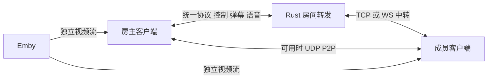
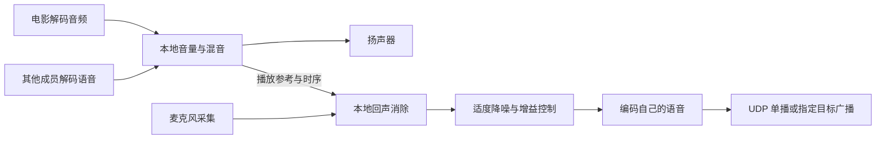

# 观影房与 Windows 客户端实施方案

2026-10-13，需求定稿，后续已按用户“执行”指令实施 0.8.0。本文保留设计依据，实际接口和组件以 [实现契约](WATCH_ROOM_IMPLEMENTATION.md) 为准，测试及待验收边界见 [执行记录](../PROJECT_STATUS.md)。本文件覆盖此前 WebRTC 优先、弹幕绑定片源和后台常驻通知建议。

指定目标广播、成员 UDP 单播互连、说话者独立发送及中转补足已接入。房主不代转其他成员声音。细节与容量分析见 [广播与成员互连方案](ROOM_BROADCAST_PLAN.md)。

“先定稿归档”的历史范围已被后续执行授权覆盖；提交、推送、发布和部署状态单独以执行记录为准。首版采用 IMA ADPCM 与平台 AEC，未引入 SpeexDSP；系统回声处理存在不代表真实外放效果已验收。下文组件候选不能视为全部已安装或验证。

## 用户已确认的需求

- App 选择控件不够优雅，需要参考苹果风格优化。
- 移除 App 当前常驻通知；后台、锁屏和断线统一按弱网恢复处理，连接尽力保留，不承诺长期后台运行。
- 通用房间可设置密码，默认无密码，由房主客户端裁决是否允许加入。修改密码不影响已入房成员；列表必须显示锁标识，允许为此调整 Rust 服务端。
- 新增观影房。房主一个人也能播放，没有准备或开始游戏阶段，成员中途加入即可跟随观看。
- 房主提供可配置片源，先支持 Emby；成员免登录 Emby。既考虑自建、可管理的 Emby，也考虑房主只有第三方账号的情况。
- 仅房主控制选片、播放、暂停和进度。
- 房间成员可以发送弹幕、开麦说话，获准成员之间可相互 UDP 单播直连；语音由说话者向各接收者分发，未走直连的目标由通用服务端广播。播放进度仍由房主决定。
- 电影视频由每位成员直接向 Emby 获取，不由房主转发。
- 首版最多 6 人，按包含房主设计；不沿用矿工最多 3 人的限制。
- 服务端尽量轻量，沿用自有统一协议。支持的客户端优先 UDP P2P，失败复用 TCP/WS 中转；语音使用自定义压缩音频包，不采用此前建议的 WebRTC/TURN 路线，不把新增 UDP 服务端中转作为前置条件。
- 房主短暂不可用时暂停等待，超过恢复期限结束房间；房主主动退出直接解散。单个成员缓冲只影响自己，恢复后追上房主，房主可手动暂停等待。
- 默认闭麦，点击后持续开麦，再点关闭；允许多人同时说话，不设置轮流上麦审批。
- 按丢包、抖动和发送积压选择 P2P/中转，弱上行可以减少直连目标；限制音频积压并丢弃过期帧，处理换网与前后台恢复。音频能力不足、无麦克风或拒绝权限时仍能观看和发弹幕。
- 弹幕属于房间，不绑定电影或进度，换片不清空、不隔离，不保留历史。
- 增加 Rust PC 客户端，仅支持 Windows，复用现有界面与玩法并支持 P2P；网页提供 Windows `.exe` 安装包或运行包下载。

不新增房主转移、后台持续语音、弹幕历史或其他桌面平台。下面的库选择、字段名、排队阈值和工程拆分是实现建议，可在保持上述业务规则和减少总代码量的前提下确定，无需反复询问已经确认的需求。

## 实施清单与顺序

| 阶段 | 待办 | 交付条件 |
| --- | --- | --- |
| 1 通用正确性 | 重连成员核对、主动断开取消重试、中转回执、UDP 路径与分片边界 | 完成优化待办中的 R1–R5 定向检查，不把 routes 当作获准名单 |
| 2 界面与生命周期 | 苹果风格选择控件、移除常驻通知、前后台弱网恢复 | 选择可用，后台不误发 LEAVE，回前台恢复，主动断开不重连 |
| 3 密码与目录 | 房主密码裁决、锁标识、密码修改与恢复 | 错误密码不入房，修改不影响现有成员，列表标识与房主设置一致 |
| 4 观影 | Emby 单人播放、六人同步、实时弹幕 | 无准备流程，中途可加入，只有房主控制，视频直接取自 Emby |
| 5 语音 | 自有协议音频、指定目标广播、质量选路、有界积压与客户端回声处理 | 六人可互听，默认闭麦，直连和中转均可用；音频不可用仍可观影和发弹幕 |
| 6 Windows | Rust 桌面端、共享 UI、跨端 P2P、网页下载 | 安装或运行包可用，PC 与 Android/网页互通；可在共享接口稳定后并行安排功能开发 |
| 7 精简与验收 | 去重复快照、存储、编解码和复制，完成跨端验收 | 优化基于测量，开发中仅做必要定向检查，功能完成后统一验收 |

这里只划分实施顺序，不授权本归档线程启动代码开发、子代理、部署或关机。Windows 技术骨架可先用已有翻棋/矿工验证，不需要等所有观影功能完成才开始。

## 需要改动的边界

| 能力 | 当前实现与后续范围 |
| --- | --- |
| 苹果风格选择控件 | 共享 Web UI 调整，Rust 不参与 |
| 房间密码裁决 | JOIN 正文已不透明转发，房主可验证并返回 allowed，无须增加密码专用服务端接口 |
| 密码标识与正式成员 | LIST 需增加公开的有密码标记，并提供房主修改标记的最小接口；恢复所需的成员状态另按 R1 定义。Rust 不验证密码、不保存媒体业务状态 |
| 播放与弹幕同步 | 可复用 SEND 与客户端模块消息，Rust 无须识别电影或弹幕 |
| 直接取流与播放器 | App 目前拦截外部资源，没有视频模块；WebView 网络策略、播放器、媒体兼容和生命周期需要调整 |
| 语音 | 压缩音频正文复用统一帧与原生 UDP，新增通用指定目标广播；Rust 只校验通用路由、资源和可丢弃消息的排队期限，不解码、混音或保存音频 |
| Emby 免登录 | 取决于 Emby 可提供的播放授权。自建可增加受限授权能力，第三方账号不能假定有单片、短期、离房即撤销的票据 |
| Windows | 新增独立桌面工程，复用共享 Web 与必要的协议逻辑；下载入口提供真实 Windows 产物，不改 APK 的既有身份与更新逻辑 |

Rust 保留通用目录、会话、路由与背压。锁标识和成员恢复允许最小必要调整，不增加电影、弹幕或语音专用服务端功能号，不引入媒体持久化和转码服务。成员状态恢复见 [重连待办](CLIENT_TRANSPORT_REVIEW.md#r1-房主恢复后出现幽灵成员)。

## 选择控件的调整方向

少量互斥选项，例如游戏类型、2/3 人、传输方式，可用分段选择或带勾选的分组列表；较长列表用底部弹出的选择面板。统一圆角、留白、字重、选中标记与取消动作，弱化桌面风格边框。不为外观引入一套大型 UI 框架。

保留键盘、读屏、焦点返回、Android 返回键、点击遮罩关闭和安全区适配。弹出时不能让后方页面误响应；横屏、键盘打开和大字体下仍可操作。共享页面采用统一组件，保留已有 MutableContextWrapper 上下文修复；不能因外观改造再次造成 App 选择弹窗失效。

涉及入口：`server/src/main/resources/web/index.html`、`app.js`、`style.css`；原生挂载逻辑在 `android_client/app/src/main/java/com/chessflipping/client/GameService.java`。

## 密码入房流程

建议在建房表单增加可选密码，空值表示无密码，密码只由房主处理，不写入公开房间名、LIST 或广播快照。密码与 Emby 登录密码是两个不同概念。

服务端为目录保存“是否有密码”的布尔标记（例如 hasPassword，最终字段名实施时统一），建房时由房主提供，LIST 返回；后续仅当前房主可更新。设密码、改密码、清空密码与列表刷新均需一致。具体命令/字段按最小扩展确定，修改后同步协议文档，不在本方案虚构已存在的功能号。

列表有锁时先输入密码，再通过 JOIN 正文提交；无锁房一次申请即可加入。目录可能过期，房主回复需能说明当前需要密码或密码错误，让客户端刷新并重试；实际准入始终由房主校验。不得把密码或校验材料塞进名称、目录或快照，也不逐个探测房主来生成锁图标。

房主验证功能版本、人数、密码和成员身份后才返回名单、播放信息及媒体授权。修改密码不踢出现有成员，也不使其有效的短暂断线恢复身份失效；已离房/过期后重新加入则按当前密码处理。恢复需要已批准身份与房间代次，不能仅凭昵称跳过密码。房主刷新后的密码校验材料保存方式属于实施细节，不能广播给成员。

至少限制单个身份的连续错误尝试，拒绝和超时申请及时释放通信关联；无后台人工审批要求时不要每次都让房主点确认。现有服务端不会根据 allowed=false 自动把关联认定为无效，因此正式成员同步和清理必须一起考虑。

客户端收到消息仍须验证发送者属于已批准名单；不能把“能向房间转发”当作“已通过密码”。当前传输不提供房主与客人之间独立于中转服务的端到端保密；若密码或 Emby 凭证需要对中转服务也保密，应另行设计客户端端到端保护，不能用一个普通哈希冒充安全的密码协议。

## 观影房生命周期

建议从 `GameRoom` 中提取实际共用的发现、入房、成员和通信逻辑，让观影模块拥有自己的播放状态。当前 `joinRequest` 会拒绝 playing 中的新成员，`memberLeft` 会重置 ready/status，`create` 把容量限制为 2–3，不能直接套用。只拆出确有三个模块共用的流程，不建立假想的插件加载或多层继承体系。

观影的业务状态可以保持为未选片、暂停、播放、结束。缓冲、授权失效、等待用户点播是播放器状态，不能全部挤进游戏 waiting/playing。房主创建房间后直接进入播放器与片源选择，成员数量不限制播放。

加入时，房主裁决成功后下发最新成员与播放状态。成员按自身播放能力取得对应取流地址，加载媒体后同步进度。系统禁止自动有声播放时显示“点击加入观影/开启声音”；房主播放指令不能绕过浏览器权限。局部网络慢的成员显示自己在缓冲，不自动暂停所有人，由房主决定是否暂停等待。[浏览器自动播放规则](https://developer.mozilla.org/en-US/docs/Web/Media/Guides/Autoplay)

房主暂时离线时，其他成员暂停等待，恢复后取最新成员和播放状态再同步；超过会话恢复期限则关闭房间与媒体会话。房主主动离开直接解散。普通成员离开不打断其他人的电影。沿用当前会话有效期作为恢复边界，不把用户可暂停电影的时长误当作会话寿命。

| 场景 | 已确认行为 |
| --- | --- |
| 成员切后台、锁屏或临时不可用 | 本地暂停播放、闭麦，连接尽力保留；回前台/恢复后重新同步房主，开麦由用户再次操作 |
| 房主切后台、锁屏 | 暂停全房并闭麦，按弱网恢复；可发送时立即通知，不可发送时由成员的失联检测进入等待 |
| 房主网络中断 | 成员暂停等待；恢复后以房主当前状态为准，超过服务端恢复期限结束房间 |
| 单个成员视频缓冲 | 不自动暂停其他人；恢复后追上房主，房主可手动暂停等待 |
| 主动断开或房主主动退出 | 与临时断线区别处理；断开取消自动重连，房主退出直接解散 |

后台事件本身不等于 LEAVE，不立即清除仍有效的成员身份。连接和身份已过期时不能用本地缓存继续保留房间或抢回旧身份。前后台切换不是新增的无限保活机制；不改变既有棋局规则，观影暂停行为放在观影模块。

## 电影与房间消息的分工

电影数据不放进现有 64 KiB 房间消息、JavaScript Base64 桥或自定义 UDP 分片。P2P 的目标是房间控制、互动和语音；是否直连不影响电影从 Emby 获取。

房主发送片目和媒体源标识、播放/暂停状态、位置、速率、递增状态版本及计时参考。成员用单调时钟和往返采样估计房主时间，不能直接相减两部手机的墙上时钟，也不能互相比裸 performance.now。换片、重新建房需区分代次，丢弃过期播放状态；弹幕不按片源隔离。

建议关键变更立即可靠送达，播放时每 1–2 秒发一次轻量进度作校准；不要照搬矿工高频全量广播。误差小时平滑修正，误差大或重连后跳转到房主进度，阈值在真实播放器上确定，避免反复 seek。单个成员回报缓冲不应触发无限全量广播。

房主拖动进度时应合并连续事件，在确认位置后发送最终值；成员仅可调本地音量、字幕、画质、全屏等，不得借本地播放器事件反向控制全房。新版状态、请求去重和中转回执必须衔接 [R3](CLIENT_TRANSPORT_REVIEW.md#r3-经中转重试的操作仍通过失效-udp-返回)。

## Emby 取流与免登录

### 共通的播放适配

片源设置包含 Emby 地址和房主的授权方式。登录凭证只交给对应 Emby，不存入公共仓库、日志、公开目录或常规房间快照；带 token 的播放 URL 也按凭证处理。房主可保存片源配置，具体本地凭证保存方式由实施线程结合 App/Web 能力确定。

先查询 PlaybackInfo，再按终端能力选择 DirectStreamUrl 或 TranscodingUrl，考虑视频编码、封装、音轨、字幕、码率和转码许可。需要为不同观看者管理独立的播放会话，不能把房主设备的一条转码地址和 PlaySessionId 机械复制给所有人。片目可相同，码率或字幕可以不同。[Emby PlaybackInfo](https://dev.emby.media/reference/RestAPI/MediaInfoService/postItemsByIdPlaybackinfo.html)

Emby 原始直传和转码的跳转处理不同；转码方案可能需要以 StartTimeTicks 重开流，客户端要把分段起点换算回同一电影时间轴。播放器支持范围和 HLS 跳转行为要与实际 Emby 版本验证。停止、换片和离房时回报/释放各自会话，避免转码任务遗留。[Emby Video Streaming](https://dev.emby.media/doc/restapi/Video-Streaming.html)

### 自建且可管理的 Emby

最低改动路线是配置仅有必要媒体播放权限的专用观影账号，由房主完成认证和选片，再为获准成员提供可播放资源。使用这个账号仍意味着成员可能取得具有该账号权限的令牌，不自动获得单片授权或离房即失效的能力。

如果需要严格限制为当前电影、短期有效并支持撤销，可在 Emby 侧增加播放授权或插件能力，只向成员发限时票据。应先核实所用版本和既有插件，官方通用认证文档未足以证明已有满足这些条件的接口。不能假定存在一个随意拼出的签名 URL。

授权服务即使新增，也应只处理授权与必要元数据；电影内容继续由 Emby 或其既有入口提供，不经房主或赛博房间 Rust 转发。如果实现必须由新的代理搬运视频流，则已经改变“直接从 Emby 获取”的既定范围，需要在实施前重新说明。

### 房主只有第三方 Emby 账号

房主登录现有账号、选片，并使用该服务器实际返回的播放资源。成员无需输入账号，但提供带 token 的 URL 或委托凭证仍属于共享播放权限，不是匿名免鉴权。不能假设第三方服务器允许 6 路播放、允许转码、接受其他公网 IP，或提供离房即撤销的单片授权；应按实际返回的限制降级或给出可理解的错误。

优先使用服务器已经支持的受限分享能力；若只有可复用账号令牌，要把暴露范围告知配置片源的房主，再决定是否支持这种分享方式。不要默认向所有成员发管理员 API Key 或登录密码。成员得到资源后可复制地址，这一点无法由房间密码或隐藏按钮阻止。

共享同一账号还可能相互覆盖 Emby 观看进度、触发并发限制；需要独立设备/会话标识并明确播放进度回报策略。房间解散可停止本客户端播放，但无法仅靠客户端保证已复制的地址立刻失效。令牌撤销也可能影响房主自己的播放，不应随成员离开就注销房主共享令牌。

以上范围来自 Emby 的一般认证机制及当前接口的设计约束；API Key 是静态令牌，用户 AccessToken 用于后续请求，注销会撤销该 token。受限分享是否存在要核对实际部署，不能把它写成已支持功能。[API Key 认证](https://dev.emby.media/doc/restapi/API-Key-Authentication.html)、[用户认证](https://dev.emby.media/doc/restapi/User-Authentication.html)

### 网络与资源条件

所有成员必须能访问 Emby，房主能播放不代表其他人能访问家中内网地址。浏览器/WebView 的 HTTPS、跨域请求、混合内容、证书、重定向、Range 请求、HLS 清单/分片与字幕地址都要纳入适配。原生播放器也不能解决远端设备不可达的问题。

六位观看者各拉一条流，若每条 8 Mbps，则 Emby 合计出口约 48 Mbps，未计协议开销；如果需要六路不同转码，还取决于 Emby 算力和并发限制。这是容量示例，不是实际测量，使用 P2P 不会消除 Emby 的视频出口压力。

## 六人语音方案

已确定使用自有统一协议。音频正文为压缩二进制，控制区或模块内的小头部携带必要的类型、流标识、序号与时间戳。与播放状态、弹幕共用通用传输，不增加服务端语音操作号。具体编码、采样率、帧长和版本协商由跨端兼容性验证决定，可采用成熟音频组件，不要求自研编解码算法。

| 路径 | 用途 | 处理边界 |
| --- | --- | --- |
| Android/Windows 的原生 UDP P2P | 双方支持且直连成功时优先使用 | 复用地址发现、加密与统一帧，落实 R3–R5；本地入队不代表对端收到 |
| TCP/WS 经 Rust 中转 | 直连失败、普通网页参与时使用 | 说话者通过通用广播一次上传并指定未走直连的目标；正文不透明转发，保留有界队列和背压 |

本轮不采用 WebRTC/TURN，不把新增服务端 UDP 业务转发列为前置条件。当前 Rust UDP 只发现地址，语音可以复用已有 TCP/WS 中转，无需为了“用了语音”另起一个媒体服务。普通网页没有与当前原生 UDP 互通的原始 Socket 能力，网页参与时走中转。[浏览器 Direct Sockets 范围](https://developer.chrome.com/docs/iwa/direct-sockets)

采用成员之间 UDP 单播互连，每个说话者编码一次自己的声音，向可直连的成员分别发送；其余成员由说话者调用通用广播指定目标，服务端直接投递，房主不再转发他人语音。各接收端独立解码与混音，外壳仍按目标链路的密钥/nonce 处理。现有 setupPeers 已尝试成员互连；新广播、混合目标调度及语音仍待实现。具体授权、去重和限流边界见 [广播方案](ROOM_BROADCAST_PLAN.md)。

客户端负责采集、编码、时间戳、抖动缓冲、播放、丢包处理、回声控制和设备切换。语音使用短小帧，尽量避免大帧分片；不能照搬游戏 action 的 400 ms 重试与完整快照回执。控制命令可靠确认，实时语音过期丢弃；发送前限制积压和速率，已经交给 TCP 的字节不能靠客户端撤回。先验证现有中转表现，再决定是否需要进一步通道隔离，不通过无限扩队列掩盖延迟。

入房默认闭麦，点击后持续说话，再点关闭，允许多人同时开麦，无上麦审批。离房、后台或权限撤销停止采集。电影与语音音量分开控制，显示说话状态，处理外放回声；单独屏蔽/音量等辅助控件可按最小可用界面实现，不扩成新的审批系统。

`room.js message` 当前统一执行 `object(m.rawBody)`，需要先按消息类型区分二进制与 JSON；底层 rawBody 已支持字节。原生端高频音频尽量留在原生层处理，减少逐包穿过 Base64/JSON/UI 回调。网页需要检测音频编码能力并提供确定的兼容范围，不能假设所有浏览器的 AudioEncoder 都可用。[AudioEncoder](https://developer.mozilla.org/en-US/docs/Web/API/AudioEncoder)

### 回声消除与音频能力降级

采用本地声学回声消除（AEC），在编码和网络发送之前处理麦克风。每台设备处理自己扬声器造成的回声；不交房主或 Rust 处理。软件 AEC 的参考必须覆盖实际输出的电影声及其他成员语音，经音量调整、混音后与采集时序对齐。只把收到的语音作为参考，会遗漏电影外放。参考信号只用于消除回声，不混进上传声音，也不把本地麦克风回放到扬声器形成循环。

这张图表达软件处理所需的数据关系；系统 AEC 的参考由系统音频路径提供，不要求应用把 PCM 手工传入系统 API。软件路径要在播放器选择阶段确认能取得播放 PCM、实际音量和时序，处理采样率与设备时钟差异；切设备、seek 或重建音频流后重新对齐。每设备一条采集处理链，播放参考汇总本机实际输出，不按房间人数重复运行一套 AEC。降噪不能替代 AEC，不能靠检测到他人说话就强行关麦来冒充支持多人同时说话。

| 平台 | 接入建议 | 必须验证的限制 |
| --- | --- | --- |
| Android | 原生 AudioRecord 使用适合通信的采集配置，先检查并试用系统 AcousticEchoCanceler；在该录音会话上管理效果实例 | 设备存在 AEC 不代表当前播放路径已覆盖电影声；验证电影和语音一起外放、双方同时讲话、音量变化及耳机切换 |
| Windows | 原生音频层优先使用可用的系统 AEC，并在接口支持时绑定实际播放输出端点作为参考 | IAcousticEchoCancellationControl 最低为 Windows Build 22621，且端点能力不保证存在；动态检测，不能因这一接口把其他系统的观影功能禁用 |
| 网页 | 通过 getUserMedia 请求浏览器回声消除，检查实际支持及设置；在支持完整输出消回声模式时优先采用 | echoCancellation=true 不保证电影或自有 WS 音频播放一定被消除；不得为触发 AEC 而偷偷改用 RTCPeerConnection 或 TURN |

平台依据：[Android AEC](https://developer.android.com/reference/android/media/audiofx/AcousticEchoCanceler)、[Android 采集来源](https://developer.android.com/reference/android/media/MediaRecorder.AudioSource#VOICE_COMMUNICATION)、[Windows AEC 参考端点](https://learn.microsoft.com/en-us/windows/win32/api/audioclient/nn-audioclient-iacousticechocancellationcontrol)、[浏览器回声消除语义](https://www.w3.org/TR/mediacapture-streams/#dom-mediatracksupportedconstraints-echocancellation)。

系统 AEC 不可用或电影参考覆盖不合格时，原生端评估独立软件 DSP 作为后备，候选为 SpeexDSP 的回声消除模块，不要求采用 Speex 编码器，不自研消回声算法，也不改变自有传输。该接口接收麦克风与播放参考，时序对齐影响效果；组件是否满足电影音乐、大音量、双人同时讲话和 CPU 预算，需小范围验证后锁定。系统与软件 AEC 不默认叠加；无法关闭或确认系统处理时，不把重复处理当作质量保证。[Speex 回声消除接口](https://www.speex.org/docs/api/speex-api-reference/group__SpeexEchoState.html)

网页还有具体限制：跨源电影即使能直接播放，也不一定能通过 Web Audio 读取 PCM；缺少允许读取的 CORS 条件时，MediaElementAudioSourceNode 必须输出静音。因此第三方 Emby 不能默认提供软件 AEC 所需参考；不要为绕过这一限制新增房间视频代理。浏览器内置 AEC 或软件参考不可用时提示使用耳机/关闭麦克风，保留观看和弹幕；播放链路仍需自身满足媒体请求条件。[Web Audio 跨源限制](https://www.w3.org/TR/webaudio-1.0/#MediaElementAudioSourceNode-security)

能力分开报告“可发送语音”“可接收语音”和必要的格式参数。无麦克风/拒绝权限只关闭采集；没有共同解码能力才禁用语音接收，不阻止入房、电影和弹幕。发送目标由发送者按获准名单与接收能力过滤。降级原因展示一次并可重新检测，不能反复弹权限窗，也不能在回前台后自动开麦。

另一项设备限制是蓝牙：部分经典蓝牙耳机启用麦克风后切换到通话模式，电影音质会下降；不同系统、设备及 LE Audio 支持有差异，不能承诺开麦前后都维持立体声。提供实际可用的输入/输出选择，在系统允许时可用设备麦克风配耳机输出；路由变化后重建采集与 AEC 参考，不假定所有组合都支持。[Windows 经典蓝牙音频](https://learn.microsoft.com/en-us/windows-hardware/drivers/bluetooth/bluetooth-classic-audio)

后续最小音频验证覆盖：只播电影、只听远端、电影加远端、双方同时讲话、调音量/seek、耳机与外放切换、来电与恢复、权限拒绝和编码不支持。记录实际回声、对本地人声的影响及 CPU/时延，接口调用成功不能代替效果验证；没有通过的设备组合明确降级，不宣称通用真机兼容。

## 弹幕与播放器交互

弹幕绑定 roomId，按房间实时发送，不携带用于隔离弹幕的电影代次/播放时间，也不随 seek 回放。换片、暂停时仍可发送和显示；换片不清空、不隔离弹幕。房间结束后停止分发，不把旧房间消息带入新房间。

不保留弹幕历史，不落盘、不持久化，也不向后来加入或重连的成员补历史。只保留显示队列和有界去重缓存所需的短时内存。通过消息 ID 和可信发送者避免重复显示，限制长度与频率，允许关闭显示；内容按文本渲染，不当作 HTML。播放状态仍可用电影代次隔离旧控制消息，不能将该规则套到弹幕。

小屏需要同时容纳视频、房主控制、成员与弹幕输入；横屏/全屏时保证字幕不被按钮挡住。原生全屏视频可能改变 Web 层弹幕覆盖能力，App 与浏览器分别确认，不承诺只加一个 video 标签即可覆盖所有场景。

## 实施前 App 阻塞记录与处理

本地 WebView 继续只放行 `https://appassets.androidplatform.net/web/`；0.8.0 通过原生受限 Emby API 桥和 Media3 播放，未开放远端页面访问 NativeRoom。首版仅支持已配置同源媒体，跨域媒体子域需后续明确授权适配。

0.8.0 已加入 RECORD_AUDIO 与 Android 运行时授权，采集在原生层，不开放 WebView 麦克风路径。普通网页采集仍要求安全上下文及浏览器授权。[Android PermissionRequest](https://developer.android.com/reference/android/webkit/PermissionRequest)、[getUserMedia](https://developer.mozilla.org/en-US/docs/Web/API/MediaDevices/getUserMedia)

已移除自建常驻通知、specialUse 前台服务声明、startForeground 调用、通知权限及 WakeLock；应用内保留断开/退出。服务仅尽力保留当前页面与连接，后台按系统限制回收。[Android 前台服务要求](https://developer.android.com/develop/background-work/services/fgs)

后台、锁屏按上面的弱网状态表处理，连接尽力保留但不做无限保活，不承诺后台持续录音。系统正常的麦克风授权与使用指示保留。旋转 Activity 不应被误认为离房或销毁有效会话；同时释放闲置唤醒锁和音频资源，避免移除通知却保留隐性的高耗电循环。来电、耳机切换、进程回收与回前台恢复属于后续定向验收。

## Windows 客户端与网页下载

Windows 是本次唯一桌面目标，支持与 Android 相同的自有协议/P2P 能力，继续复用 App/Web 的界面和玩法。技术建议采用 Rust＋Tauri，Rust 承接 TCP/WS、UDP、设置和必要原生音频，页面负责共用 UI 与业务；这是一项实现选择，不要求用户再次选择 UI 框架。Tauri 使用系统 WebView，Windows 为 WebView2，安装包需处理其运行时依赖。[Tauri 架构](https://v2.tauri.app/concept/architecture/)、[Windows 打包](https://v2.tauri.app/distribute/windows-installer/)

| 对端组合 | 预期路径 |
| --- | --- |
| Windows 与 Windows | 原生 UDP P2P，失败用 TCP/WS 中转 |
| Windows 与 Android | 同一 v3 外壳、加密和 UDP 协商，直连优先，失败中转 |
| Android 与 Android | 保留已有能力并修复 R3–R5 |
| 普通网页与任意端 | WS 中转，不因为有 PC 端就声称普通网页获得原始 UDP |

建议新增独立 desktop_client 工程，只提取确有复用价值的协议纯逻辑，不把 Axum/Hub 等服务端状态带进 PC，不顺带重写 Android Java 工程。复用实现时核对客户端与服务端密钥方向、nonce、防重放、分片和超时；统一协议不等于两侧代码可原样照搬。

现有 NativeRoom 的设置读取与发送结果是同步接口，Tauri 调用通常异步；共享页面需要一个薄适配层和明确的入队/失败语义，不能把 Promise 当作 true。按实际能力声明 UDP、音频和模块版本，不再仅以“有 native 对象”推断全部能力。二进制传输优先使用原始字节通道，避免为 PC 复制 Base64 热路径；不宣称跨进程零拷贝。[Tauri 调用 Rust](https://v2.tauri.app/develop/calling-rust/)

网页新增清楚区分 Android 与 Windows 的下载入口，提供真实可下载的 `.exe` 安装包或运行包，格式可按依赖打包条件选择。下载文件附版本、大小和校验信息；服务端通过静态发布资源提供，避免为每个平台增加一套专用二进制协议。构建产物进入发布流程或忽略目录，不提交到源码。现有 APK 清单、包名检查及自动更新行为保持兼容，不能把 Windows 产物冒充 APK。

PC 默认连接配置沿用 TCP / fqgame.tdcode.tech / 8888，设置可修改且升级保留。先用现有大厅/翻棋/矿工验证窗口、连接、退出、恢复和跨端互通，再接观影与音频。睡眠唤醒和网络切换按弱网恢复；不因 Windows 端存在就承诺房主断线后的房主迁移。macOS/Linux 不属于本次交付。

## 实施顺序与必要验收

按前面的实施清单推进。开发阶段只做相关的最小编译与定向检查，功能完成后统一修复和验收；不提前反复跑全面回归。以下是后续验收目标，不是本轮已运行检查。

1. 无密码旧房间照常加入，密码错误不取得媒体授权，正确密码可加入；修改密码不影响现有成员及其有效恢复，退出后按新密码加入；锁标识随设定/清空更新，非房主不能修改。
2. 房主独自选片与播放；第 2–6 人中途加入能跟随，第 7 人被明确拒绝；普通成员退出不暂停全房，房主退出解散。
3. 验证暂停、播放、拖动、换片、晚加入、短暂断线及过期消息；成员本地控制不影响房主。
4. 各用一个可管理和一个第三方 Emby 环境做授权/并发验证，至少覆盖可直传资源与需要转码/字幕的资源；没有测试环境时明确保留未验证项，不自行创建付费服务。
5. 确认视频网络请求直接到 Emby；房主与 Rust 带宽不随电影码率承担全片中转。
6. 弹幕在暂停/换片后继续属于同一房间，后来加入与重连不补历史，重复包不重复显示，退出后不串到其他房间。
7. 六人语音互相可听见且不回送自己；默认闭麦、点击开关、后台闭麦、拒绝权限仍可观影。验证 UDP 直连、单向故障及 TCP/WS 中转，不用语音重传堆积旧声音。
8. App 不再显示自建常驻通知，连接启动和前后台切换不触发前台服务错误。成员回前台追上房主，房主不可用时全房等待，超过会话期限解散；主动断开不自动重连。
9. Windows 包通过网页下载后可安装/运行，PC 与 Android 的 P2P/中转互通，普通网页可加入同房，更新元数据不污染 APK。核对弱网恢复和新旧客户端能力不匹配提示。
10. 核对资源白名单、选择控件、横竖屏、全屏、自动播放受阻与恢复；模拟器/本机编译通过不能替代主流真机、实际网络和其他 Windows 环境验证。

核心业务规则已确认。余下是实际 Emby 授权/并发与媒体兼容、跨端音频组件、六人性能、Windows 打包和网络互通的技术验证，不再将已定的通知、密码、弹幕、开麦和平台范围列为待确认。

早期归档阶段仅整理文档；后续 0.8.0 已实施并进行本地跨端检查，实际 Emby、外放回声及设备兼容仍按执行记录列为待验收。发布与部署状态以 PROJECT_STATUS.md 为准。
