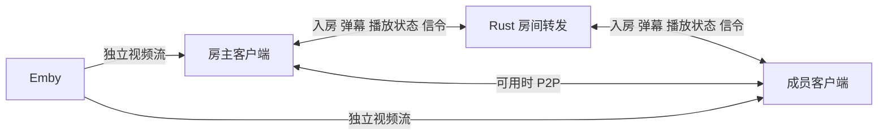

# 观影房与房间密码方案

2026-10-13。用户要求先记录待办并推送，后续另开线程实施；本轮不修改业务代码。本方案结合当前赛博房间 v3 实现，区分已确认需求、实现建议与待验证条件。通用重连、传输和简化事项见 [客户端与传输优化待办](CLIENT_TRANSPORT_REVIEW.md)。

## 用户已确认的需求

- App 选择控件不够优雅，需要参考苹果风格优化。
- 通用房间可设置密码，默认无密码，由房主客户端裁决是否允许加入；尽量复用现有服务端能力。
- 新增观影房。房主一个人也能播放，没有准备或开始游戏阶段，成员中途加入即可跟随观看。
- 房主提供可配置片源，先支持 Emby；成员免登录 Emby。既考虑自建、可管理的 Emby，也考虑房主只有第三方账号的情况。
- 仅房主控制选片、播放、暂停和进度。
- 房间成员可以发送弹幕、开麦说话，成员与房主通过 P2P 或服务端通信，同步语音、弹幕和进度。
- 电影视频由每位成员直接向 Emby 获取，不由房主转发。
- 首版最多 6 人，按包含房主设计；不沿用矿工最多 3 人的限制。

房主退出直接解散是现有房间规则，本方案暂沿用，不新增房主转移。更改此规则、后台持续语音、播放列表和历史弹幕不是本轮已经确认的需求。

## 需要改动的边界

| 能力 | 当前实现与后续范围 |
| --- | --- |
| 苹果风格选择控件 | 共享 Web UI 调整，Rust 不参与 |
| 房间密码裁决 | JOIN 正文已不透明转发，房主可验证并返回 allowed，无须增加密码专用服务端接口 |
| 密码标识与正式成员 | LIST 只返回 ID、名字和房主，没有公开密码标识；Rust routes 也不是获准名单。若需列表锁标识、服务端强制撤销/限流，应另行明确通用元数据和成员接口，不能宣称所有要求均为纯客户端改动 |
| 播放与弹幕同步 | 可复用 SEND 与客户端模块消息，Rust 无须识别电影或弹幕 |
| 直接取流与播放器 | App 目前拦截外部资源，没有视频模块；WebView 网络策略、播放器、媒体兼容和生命周期需要调整 |
| 语音 | 当前无采集、编解码、播放和语音传输实现；复用 SEND 传信令可行，现有 Rust TCP/WS 中转不等于 WebRTC 的 TURN 服务 |
| Emby 免登录 | 取决于 Emby 可提供的播放授权。自建可增加受限授权能力，第三方账号不能假定有单片、短期、离房即撤销的票据 |

“密码由客户端检查”成立，但不代表“完整观影功能必然不增加任何服务”。成员状态恢复仍按用户最新要求处理，见 [重连待办](CLIENT_TRANSPORT_REVIEW.md#r1-房主恢复后出现幽灵成员)。

## 选择控件的调整方向

少量互斥选项，例如游戏类型、2/3 人、传输方式，可用分段选择或带勾选的分组列表；较长列表用底部弹出的选择面板。统一圆角、留白、字重、选中标记与取消动作，弱化桌面风格边框。不为外观引入一套大型 UI 框架。

保留键盘、读屏、焦点返回、Android 返回键、点击遮罩关闭和安全区适配。弹出时不能让后方页面误响应；横屏、键盘打开和大字体下仍可操作。共享页面采用统一组件，保留已有 MutableContextWrapper 上下文修复；不能因外观改造再次造成 App 选择弹窗失效。

涉及入口：`server/src/main/resources/web/index.html`、`app.js`、`style.css`；原生挂载逻辑在 `android_client/app/src/main/java/com/chessflipping/client/GameService.java`。

## 密码入房流程

建议在建房表单增加可选密码，空值表示无密码，密码只由房主处理，不写入公开房间名、LIST 或广播快照。密码与 Emby 登录密码是两个不同概念。

沿用 JOIN：客人首次申请，房主按房间设置返回允许，或返回需要密码的明确原因；客户端显示密码输入，再提交申请。现有 JOIN 可以透传模块定义的原因字段，无需 Rust 解析。无密码房保持一次申请即可加入。若以后需要列表上直接显示锁，应使用明确的目录元数据设计，不能把密码或私密信息塞进名称，也不建议进入大厅后挨个探测房主。

房主验证功能版本、人数、密码和成员身份后才返回名单、播放信息及媒体授权。断线恢复需要关联已批准的成员身份与房间代次，不能仅凭昵称跳过密码。修改密码是否只影响新加入者、刷新后房主如何保留密码校验材料，实施时需定义；建议改密码默认不踢出现有成员。

至少限制单个身份的连续错误尝试，拒绝和超时申请及时释放通信关联；无后台人工审批要求时不要每次都让房主点确认。现有服务端不会根据 allowed=false 自动把关联认定为无效，因此正式成员同步和清理必须一起考虑。

客户端收到消息仍须验证发送者属于已批准名单；不能把“能向房间转发”当作“已通过密码”。当前传输不提供房主与客人之间独立于中转服务的端到端保密；若密码或 Emby 凭证需要对中转服务也保密，应另行设计客户端端到端保护，不能用一个普通哈希冒充安全的密码协议。

## 观影房生命周期

建议从 `GameRoom` 中提取实际共用的发现、入房、成员和通信逻辑，让观影模块拥有自己的播放状态。当前 `joinRequest` 会拒绝 playing 中的新成员，`memberLeft` 会重置 ready/status，`create` 把容量限制为 2–3，不能直接套用。只拆出确有三个模块共用的流程，不建立假想的插件加载或多层继承体系。

观影的业务状态可以保持为未选片、暂停、播放、结束。缓冲、授权失效、等待用户点播是播放器状态，不能全部挤进游戏 waiting/playing。房主创建房间后直接进入播放器与片源选择，成员数量不限制播放。

加入时，房主裁决成功后下发最新成员与播放状态。成员按自身播放能力取得对应取流地址，加载媒体后同步进度。系统禁止自动有声播放时显示“点击加入观影/开启声音”；房主播放指令不能绕过浏览器权限。局部网络慢的成员应显示自己在缓冲，建议首版不自动暂停所有人，由房主决定是否暂停等待。[浏览器自动播放规则](https://developer.mozilla.org/en-US/docs/Web/Media/Guides/Autoplay)

房主暂时离线时显示恢复状态，建议客人暂停等待，恢复后取最新状态再同步；超过现有会话宽限或房主主动离开则关闭房间与媒体会话。普通成员离开不打断其他人的电影。以上暂停策略属于实现建议，用户尚未逐项确认。

## 电影与房间消息的分工

电影数据不放进现有 64 KiB 房间消息、JavaScript Base64 桥或自定义 UDP 分片。P2P 的目标是房间控制、互动和语音；是否直连不影响电影从 Emby 获取。

房主发送片目和媒体源标识、播放/暂停状态、位置、速率、递增状态版本及计时参考。成员用单调时钟和往返采样估计房主时间，不能直接相减两部手机的墙上时钟，也不能互相比裸 performance.now。切片、换片、重新建房需区分代次，丢弃过期状态。

建议关键变更立即可靠送达，播放时每 1–2 秒发一次轻量进度作校准；不要照搬矿工高频全量广播。误差小时平滑修正，误差大或重连后跳转到房主进度，阈值在真实播放器上确定，避免反复 seek。单个成员回报缓冲不应触发无限全量广播。

房主拖动进度时应合并连续事件，在确认位置后发送最终值；成员仅可调本地音量、字幕、画质、全屏等，不得借本地播放器事件反向控制全房。新版状态、请求去重和中转回执必须衔接 [R3](CLIENT_TRANSPORT_REVIEW.md#r3-经中转重试的操作仍通过失效-udp-返回)。

## Emby 取流与免登录

### 共通的播放适配

片源设置包含 Emby 地址和房主的授权方式。登录凭证只交给对应 Emby，不存入公共仓库、日志、公开目录或常规房间快照；带 token 的播放 URL 也按凭证处理。房主可保存片源配置，具体本地凭证保存方式由实施线程结合 App/Web 能力确定。

先查询 PlaybackInfo，再按终端能力选择 DirectStreamUrl 或 TranscodingUrl，考虑视频编码、封装、音轨、字幕、码率和转码许可。需要为不同观看者管理独立的播放会话，不能把房主设备的一条转码地址和 PlaySessionId 机械复制给所有人。片目可相同，码率或字幕可以不同。[Emby PlaybackInfo](https://dev.emby.media/reference/RestAPI/MediaInfoService/postItemsByIdPlaybackinfo.html)

Emby 原始直传和转码的跳转处理不同；转码方案可能需要以 StartTimeTicks 重开流，客户端要把分段起点换算回同一电影时间轴。播放器支持范围和 HLS 跳转行为要与实际 Emby 版本验证。停止、换片和离房时回报/释放各自会话，避免转码任务遗留。[Emby Video Streaming](https://dev.emby.media/doc/restapi/Video-Streaming.html)

### 自建且可管理的 Emby

最低改动路线是配置仅有必要媒体播放权限的专用观影账号，由房主完成认证和选片，再为获准成员提供可播放资源。使用这个账号仍意味着成员可能取得具有该账号权限的令牌，不自动获得单片授权或离房即失效的能力。

如果需要严格限制为当前电影、短期有效并支持撤销，可在 Emby 侧增加播放授权或插件能力，只向成员发限时票据。应先核实所用版本和既有插件，官方通用认证文档未足以证明已有满足这些条件的接口。不能假定存在一个随意拼出的签名 URL。

授权服务即使新增，也应只处理授权与必要元数据；电影内容继续由 Emby 或其既有入口提供，不经房主或赛博房间 Rust 转发。如果实现必须由新的代理搬运视频流，则已经改变“直接从 Emby 获取”的既定范围，需要在实施前重新说明。

### 房主只有第三方 Emby 账号

房主登录现有账号、选片，并使用该服务器实际返回的播放资源。成员无需输入账号，但提供带 token 的 URL 或委托凭证仍属于共享播放权限，不是匿名免鉴权。不能假设第三方服务器允许 6 路播放、允许转码、接受其他公网 IP，或提供离房即撤销的单片授权；应按实际返回的限制降级或给出可理解的错误。

优先使用服务器已经支持的受限分享能力；若只有可复用账号令牌，要把暴露范围告知配置片源的房主，再决定是否支持这种分享方式。不要默认向所有成员发管理员 API Key 或登录密码。成员得到资源后可复制地址，这一点无法由房间密码或隐藏按钮阻止。

共享同一账号还可能相互覆盖 Emby 观看进度、触发并发限制；需要独立设备/会话标识并明确播放进度回报策略。房间解散可停止本客户端播放，但无法仅靠客户端保证已复制的地址立刻失效。令牌撤销也可能影响房主自己的播放，不应随成员离开就注销房主共享令牌。

以上范围来自 Emby 的一般认证机制及当前接口的设计约束；API Key 是静态令牌，用户 AccessToken 用于后续请求，注销会撤销该 token。受限分享是否存在要核对实际部署，不能把它写成已支持功能。[API Key 认证](https://dev.emby.media/doc/restapi/API-Key-Authentication.html)、[用户认证](https://dev.emby.media/doc/restapi/User-Authentication.html)

### 网络与资源条件

所有成员必须能访问 Emby，房主能播放不代表其他人能访问家中内网地址。浏览器/WebView 的 HTTPS、跨域请求、混合内容、证书、重定向、Range 请求、HLS 清单/分片与字幕地址都要纳入适配。原生播放器也不能解决远端设备不可达的问题。

六位观看者各拉一条流，若每条 8 Mbps，则 Emby 合计出口约 48 Mbps，未计协议开销；如果需要六路不同转码，还取决于 Emby 算力和并发限制。这是容量示例，不是实际测量，使用 P2P 不会消除 Emby 的视频出口压力。

## 六人语音方案

弹幕和播放控制可以先使用现有可靠中转与 P2P 能力；语音需要采集、编码、抖动缓冲、丢包处理、回声消除、混音和设备切换，不能只把录音字节丢进 SEND 就算完成。

| 选项 | 收益 | 代价与范围 |
| --- | --- | --- |
| WebRTC 音轨，信令复用 SEND | App WebView 与浏览器可采用标准实时音频能力，媒体优先直连 | 跨 NAT 失败需要可用 TURN 中转；现有 Rust 不实现 TURN，可能需要独立部署/配置。ICE/SDP 只是信令，不能把 SRTP 媒体直接塞入现有 SEND 冒充 TURN |
| 自定义压缩音频包走现有 P2P 或 Rust 中转 | 能复用现有通道及房主转发规则 | 客户端需补编码、播放时钟、缓冲、丢旧帧、混音等；TCP/WS 丢包时还会排队阻塞，跨端实现量与调试成本更高 |

技术建议优先评估 WebRTC，是否增加 TURN 仍是实施选择，不是本轮已部署或已确认的服务。WebRTC 信令可自选传递方式；需要中转时 TURN 提供的是网络可达性，不提供房间准入或群组混音。[WebRTC 信令](https://webrtc.org/getting-started/peer-connections)、[TURN 中转](https://webrtc.org/getting-started/turn-server)

按用户的“成员与房主通信”优先评估星形拓扑：每位成员只连房主，但房主必须把某位成员的声音分发给其他成员，且不能返送给说话者。只让每个人分别与房主建立连接，会导致客人之间听不到彼此。逐音轨转发与混音后发送的成本不同，应做六人小样验证房主手机 CPU、上行与延迟；不能把它当作现成的 SFU。成员全互连或独立媒体服务器是可选替代，不默认扩大到它们。

建议入房默认闭麦，用户点开麦后请求权限；提供自己的静音、单个成员音量/屏蔽、房主禁麦/移除及说话状态。电影音量与语音音量分开控制，评估回声和电影外放串入麦克风，离房或权限撤销立即停止采集。默认麦克风策略与后台行为属于建议，实施前细化。

## 弹幕与播放器交互

建议弹幕按当前房间实时发送，携带消息 ID、可信发送者及电影代次/时间位置；避免中转重试显示两次，换片后不串到新片。首版不默认保存历史回放，需限制长度和频率，并允许成员关闭显示及屏蔽。弹幕内容按文本渲染，不当作 HTML。

房主暂停、拖动时的弹幕呈现、进房后是否补少量聊天记录仍需确定。建议把实时聊天与历史影片弹幕区分开，避免一开始引入持久化服务。

小屏需要同时容纳视频、房主控制、成员与弹幕输入；横屏/全屏时保证字幕不被按钮挡住。原生全屏视频可能改变 Web 层弹幕覆盖能力，App 与浏览器分别确认，不承诺只加一个 video 标签即可覆盖所有场景。

## 当前 App 的直接阻塞点

`GameService` 仅放行 `https://appassets.androidplatform.net/web/`，CSP 的 connect-src 为 self，默认资源策略也限制外部媒体。观影需按已配置片源和实际播放链路放行媒体/API 请求，并处理合法的重定向与媒体子域；不能为了播放开放任意远端页面访问 NativeRoom 桥接。

Manifest 当前没有 RECORD_AUDIO，也没有 WebChromeClient 的音频权限处理。需要 Android 运行时授权与 WebView `RESOURCE_AUDIO_CAPTURE` 两层处理，验证可信本地 origin，只授予实际需要的资源。浏览器采集还要求安全上下文。[Android PermissionRequest](https://developer.android.com/reference/android/webkit/PermissionRequest)、[getUserMedia](https://developer.mozilla.org/en-US/docs/Web/API/MediaDevices/getUserMedia)

当前前台服务为 specialUse，不能据此承诺锁屏或后台持续录音。若要后台语音，需要另行核对 Android 对麦克风前台服务、启动时机和系统权限的要求；首版可先明确离开前台后的暂停/闭麦行为。来电、蓝牙耳机切换、旋转 Activity、WebView 重建和进程恢复也属于后续定向验收场景。

## 实施顺序与必要验收

建议先处理通用恢复/断开/可靠回执，再做选择控件与密码；随后完成 Emby 单人播放、六人同步与弹幕，最后接入语音并验证直连失败的中转路径。这个顺序不删减用户的语音需求，也不构成“今天一定全部完成”的时间承诺。

1. 无密码旧房间照常加入，密码错误不取得媒体授权，正确密码可加入；已批准成员恢复不重复占座。
2. 房主独自选片与播放；第 2–6 人中途加入能跟随，第 7 人被明确拒绝；普通成员退出不暂停全房，房主退出解散。
3. 验证暂停、播放、拖动、换片、晚加入、短暂断线及过期消息；成员本地控制不影响房主。
4. 各用一个可管理和一个第三方 Emby 环境做授权/并发验证，至少覆盖可直传资源与需要转码/字幕的资源；没有测试环境时明确保留未验证项，不自行创建付费服务。
5. 确认视频网络请求直接到 Emby；房主与 Rust 带宽不随电影码率承担全片中转。
6. 六人弹幕与语音，验证成员互相可听见、无自己回声、关闭麦克风即停止采集、拒绝权限仍可看电影；直连受阻时用所选方案真正中转。
7. 核对 App 外部资源白名单、原生选择控件、横竖屏、全屏、自动播放受阻与恢复；模拟器通过不能替代主流真机兼容验证。

当前没有实现上述功能，也没有进行 Emby 登录、真实取流、六人联机、语音或真机测试。本轮只有现有源码核对与官方接口资料查阅；具体 Emby 版本、播放器选择、受限授权能力、TURN 部署方式和后台行为留待实现阶段确定。
